# Memoria — Local-First Semantic Desktop Search & RAG Assistant

Memoria is a privacy-first, local neural search engine and Retrieval-Augmented Generation (RAG) assistant for personal files and documents. It indexes PDFs, Word documents, PowerPoint presentations, plain text/code files, and images, enabling natural language search, version/temporal-aware document retrieval, and interactive question-answering with verifiable citations—running entirely on your personal computer.

---

## Architecture Overview

```mermaid
flowchart TD
    subgraph Ingestion ["1. INGESTION & DOCUMENT PROCESSING"]
        FW[Watchdog File Watcher] -->|Detect changes| IS[Indexing Service]
        IS --> DocProc[Processors: PDF, DOCX, PPTX, TXT, Images]
        DocProc -->|Visual description + OCR| Vision[Image Processor]
        DocProc --> Chunker[Sliding-Window Chunker]
        Chunker --> DB[(SQLite: folders, files, chunks)]
        Chunker --> Emb[Local ONNX all-MiniLM-L6-v2]
        Emb --> FAISS[(FAISS Vector Index: 384-dim)]
    end

    subgraph SearchPipeline ["2. HYBRID SEARCH & INTENT RERANKING"]
        Query[User Query in UI] --> Intent[Query Intent & Temporal Parser]
        Query --> QEmb[Query Vector Embedding]
        QEmb --> FAISSSearch[FAISS Cosine Similarity Retrieval]
        FAISSSearch --> Boost[Keyword & Exact Filename Match Boost]
        Boost --> Rerank[Intent & Temporal Reranking]
        Rerank --> SearchOut[Ranked Results with Confidence %]
        Rerank --> RAGPrompt[Context Builder]
        RAGPrompt --> LLM[RAG Answer with Verified Citations]
    end
```



---

## Core Features

- **Local-First & Privacy Preserving**:
  Document text, metadata, embeddings, and vector similarity calculations stay local on your machine.
- **Multimodal Document Ingestion**:
  - **PDFs**: Page-by-page extraction preserving exact citation boundaries.
  - **Office Documents (`.docx`, `.pptx`)**: Paragraphs, headings, bullet lists, slide titles, tables.
  - **Text & Code (`.txt`, `.md`, `.py`, `.json`, etc.)**: Fast UTF-8 native extraction.
  - **Images (`.png`, `.jpg`, `.jpeg`, `.webp`)**: Dual-pass extraction combining visual scene description, tag classification, and OCR text transcription.
- **Local Neural Embeddings**:
  Powered by `sentence-transformers/all-MiniLM-L6-v2` via **ONNX Runtime** (384-dimensional vectors). Optimized for CPU inference (~14ms per sentence) with a 256-query LRU cache.
- **FAISS Vector Index with Memory-Mapping**:
  Uses `IndexIDMap(IndexFlatIP)` mapped to SQLite `chunk_id`s, loaded via `faiss.IO_FLAG_MMAP` for instant, low-RAM startups across tens of thousands of vectors.
- **Hybrid Search Scoring**:
  Combines cosine vector similarity with lexical keyword boosting, exact filename matching, and user bias, capped cleanly at 1.0 (100% confidence).
- **Temporal & Version-Aware Intent Search**:
  Understands version queries (e.g., *"latest resume"*, *"old notes"*, *"v2"*) and temporal anchors (e.g., *"resume before Stanford intern"*).
- **Grounded RAG with Citations**:
  Chat with your document corpus. Every generated response includes exact source document links and page numbers.
- **Real-Time Watcher & Folder Management**:
  Continuous background monitoring via Watchdog. Individual folders (e.g., `Downloads`) can be paused to preserve indexed files without ingesting new ones.

---

## Tech Stack

| Layer | Technologies |
| :--- | :--- |
| **Backend** | Python 3.12, FastAPI, Uvicorn |
| **Vector Engine** | FAISS (`IndexIDMap` over `IndexFlatIP`) with MMAP |
| **Embeddings** | ONNX Runtime (`all-MiniLM-L6-v2`, 384 dimensions) |
| **Database** | SQLite (WAL mode, foreign keys, indexed chunk IDs) |
| **File Watcher** | Watchdog (native OS directory monitoring) |
| **Frontend** | React 18, Vite, Tailwind CSS, Lucide Icons, KaTeX |

---

## Project Structure

```
memoria-iteration1/
├── backend/
│   ├── main.py                  # FastAPI application entrypoint and lifespan lifecycle
│   ├── config/settings.py       # Centralized configuration & storage paths
│   ├── db/
│   │   ├── database.py          # SQLite connection manager (WAL mode) & schema
│   │   └── repositories.py      # FolderRepository, FileRepository, ChunkRepository
│   ├── processors/
│   │   ├── chunker.py           # Sliding-window text chunker (500 tokens with overlap)
│   │   ├── pdf_processor.py     # PDF text extraction with page numbers
│   │   ├── docx_processor.py    # Microsoft Word text extractor
│   │   ├── pptx_processor.py    # PowerPoint presentation extractor
│   │   ├── txt_processor.py     # Plain text & source code extractor
│   │   ├── image_processor.py   # Image scene analysis, visual tags & OCR
│   │   └── file_utils.py        # File hashing and format validators
│   ├── services/
│   │   ├── embedding_service.py # ONNX all-MiniLM-L6-v2 embedding model wrapper
│   │   ├── search_service.py    # Hybrid search, keyword/filename boosting, scoring
│   │   ├── query_intent.py      # Version & temporal intent extraction engine
│   │   ├── document_service.py  # End-to-end extraction, embedding, & indexing worker
│   │   ├── indexing_service.py  # Folder scanner and diff detector
│   │   └── file_watcher_service.py # Live file monitoring service via Watchdog
│   ├── vector/
│   │   └── faiss_index.py       # Thread-safe, memory-mapped FAISS index wrapper
│   ├── schemas/                 # Pydantic request/response models
│   └── api/
│       ├── search.py            # GET /search endpoint
│       ├── rag.py               # POST /rag and POST /rag/stream endpoints
│       ├── files.py             # File metadata, previews, and statistics
│       ├── folders.py           # Folder management (add, remove, pause/resume)
│       └── health.py            # GET /health system status endpoint
├── frontend/
│   ├── src/
│   │   ├── App.jsx              # Navigation and main tab views
│   │   ├── SearchPage.jsx       # Semantic search interface with confidence bars
│   │   ├── FormattedAnswer.jsx  # RAG answer renderer with interactive citation pills
│   │   ├── SettingsPage.jsx     # Monitored folder configuration & pause toggles
│   │   └── index.css            # Styling and theme rules
│   ├── package.json
│   └── vite.config.js
├── start.bat                    # Windows one-click backend + frontend launcher
├── start.ps1                    # PowerShell launcher
├── stop.bat                     # Gracefully stops running services
└── README.md
```

---

## Getting Started

### Prerequisites

- **Python**: 3.11 or 3.12
- **Node.js**: v18+ and `npm`
- **Operating System**: Windows, macOS, or Linux

### Installation

1. **Clone the repository**:
   ```bash
   git clone https://github.com/smerarawal/Memoria-Local-First-Semantic-Desktop-Search-and-RAG-assistant.git
   cd Memoria-Local-First-Semantic-Desktop-Search-and-RAG-assistant
   ```

2. **Set up the Backend**:
   ```bash
   cd backend
   python -m venv venv
   # On Windows:
   venv\Scripts\activate
   # On Linux/macOS:
   source venv/bin/activate

   pip install -r requirements.txt
   ```

3. **Set up the Frontend**:
   ```bash
   cd ../frontend
   npm install
   ```

### Running the Application

#### Option A: One-Click Launcher (Windows)
Double-click `start.bat` (or execute `.\start.ps1` in PowerShell). This launches:
- Backend server on `http://localhost:8000`
- Frontend UI on `http://localhost:5173`
- Automatically opens the browser to the application

#### Option B: Manual Execution
**Terminal 1 (Backend):**
```bash
cd backend
python -m uvicorn main:app --port 8000 --reload
```

**Terminal 2 (Frontend):**
```bash
cd frontend
npm run dev
```

---

## Detailed System Mechanics

### 1. Hybrid Search Scoring Formula

When a user submits a search query, candidates are retrieved and evaluated through a multi-factor scoring function:

$$\text{Final Score} = \min\left(1.0,\; \text{Cosine Similarity} + \text{Keyword Boost} + \text{Filename Boost} + \text{User Bias}\right)$$

- **Cosine Similarity**: Vector dot product from the 384-dimensional ONNX embedding model.
- **Keyword Boost**: Direct substring occurrences of search terms in chunk text add $+0.22$ per word (capped at $+0.55$).
- **Filename Match Boost**: Exact term matches in file names add $+0.20$ per match (up to $+0.40$).
- **Normalization**: Results are capped at $1.0$ (100% confidence) to prevent score distortion.

### 2. Intent-Aware Temporal Reranking

For versioned documents (e.g. resumes, project proposals, agreements), traditional semantic search struggles to differentiate versions. Memoria's `query_intent.py` engine parses:
- **Relative version signals**: *"latest"*, *"newest"*, *"old"*, *"first"*, *"v2"*.
- **Temporal anchor milestones**: *"resume before Stanford intern"*, *"notes after May 2024"*.
- Evaluates candidate dates, version numbers, and chunk milestone presence, reranking the matching version to the top.

### 3. Memory-Safe FAISS Loading

To handle large indices across tens of thousands of chunks without high memory consumption or BLAS thread contention:
- Index is opened via `faiss.IO_FLAG_MMAP` (memory-mapped file I/O).
- Environment variables (`OPENBLAS_NUM_THREADS=1`, `OMP_NUM_THREADS=1`, `MKL_NUM_THREADS=1`) prevent thread allocation overhead.

---

## API Reference

| Method | Endpoint | Description |
| :--- | :--- | :--- |
| `GET` | `/health` | Check backend and database connectivity status |
| `GET` | `/search?q={query}&top_k={k}` | Hybrid semantic search returning ranked files |
| `POST` | `/rag` | Question-answering over indexed corpus with grounded citations |
| `POST` | `/rag/stream` | Server-Sent Events (SSE) streaming RAG response |
| `GET` | `/folders` | List all monitored folders and indexing statuses |
| `POST` | `/folders` | Add a new folder path to monitor and index |
| `PATCH`| `/folders/{id}` | Toggle folder status between Active (`enabled=1`) and Paused (`enabled=0`) |
| `GET` | `/files` | List indexed files with metadata and chunk counts |
| `POST` | `/index` | Manually trigger indexing on pending files |

---

## License

This project is licensed under the MIT License.
